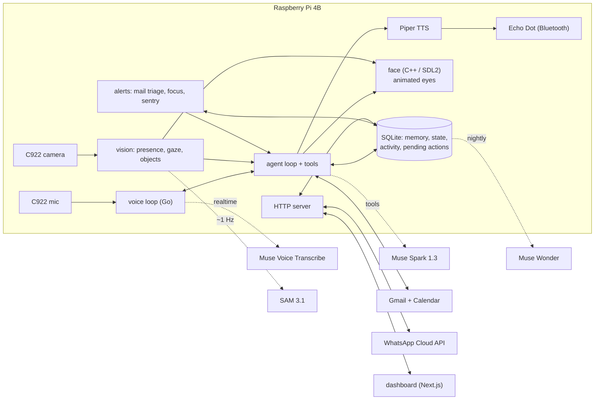

# Fritz

**A desk companion that guards your attention.** Fritz sits on your desk
with animated eyes, sees when you're there, listens when you talk to him,
and keeps track of what you'd otherwise miss: holding back email that can
wait while you focus, interrupting only for what can't, reminding you
where you stopped when you come back, and reaching you on WhatsApp when
you're away.

Built for the Meta Global AI Hackathon on a Raspberry Pi 4 Model B with Meta's
models: Muse Spark, SAM 3.1, Muse Voice Transcribe and Muse Wonder, and
coded with Muse Code and Claude Code.

<!-- Demo video: paste the link here before submitting, e.g. "**[Watch the 3-minute demo](https://...)**". -->

## The problem

When you're heads-down, you either get pulled out by things that could
have waited, or you miss the one message that couldn't. Notification
settings don't know the difference, and they don't know you.

## What Fritz does

| You say or do | Fritz |
|---|---|
| "Let me focus for 30 minutes." | Holds email that can wait. Interrupts only for what can't wait until your focus ends ("sorry to interrupt — your card payment failed"). When time's up, one short spoken digest. |
| "Hold project updates unless there's a deadline." | Remembers the rule and applies it from the next email on. Rules show on the dashboard. |
| You sit down at your desk | His eyes find you and he says hello right away, then checks your email and calendar and mentions the one thing that matters ("Sarah from London needs an answer on Thursday today"). |
| You step away for a moment and come back | A one-line check-in: "All good? Anything I can help with?" You can just answer, no wake phrase needed. Never during focus time. |
| "I'm stopping at the pricing section." Then you leave. | When the camera sees you sit back down, his eyes turn to you: "Welcome back. You stopped at the pricing section, and Dana sent the weekly update while you were out." |
| An important email arrives while you're away | A WhatsApp message. Reply there ("what does it say?", "tell her Thursday works") and Fritz answers with the same tools he has at the desk. |
| "Reply to Dana that Thursday works." | Reads the reply back and sends it only after you say yes. This is enforced in code, not left to the model. |
| "Where are my keys?" | Looks with the camera, turns his eyes to them, or says where and when he last saw them. |
| "Sentry mode, I'm heading out." | Anyone who walks up to your desk gets you a WhatsApp photo. |

Everything Fritz did, what he's holding for you, and what he has learned
about your routines is on a live dashboard (`web/`), with each entry
tagged with the Meta model behind it.

## Meta models

| Model | What it does in Fritz | Code |
|---|---|---|
| **Muse Spark 1.3** | The agent: conversation, tool calling (email, calendar, focus, rules, sentry), deciding which email is important, urgent, or held by your rules, and answering questions about what the camera sees | `api/internal/agent`, `api/internal/alerts/mail.go`, `api/internal/chat` |
| **SAM 3.1** | Fritz's eyes: finds you in the camera frame about once a second so his eyes follow you and he knows when you arrive or leave, and finds named objects ("keys") anywhere on the desk | `api/internal/vision` |
| **Muse Voice Transcribe** | His ears: realtime streaming speech-to-text from the webcam mic | `api/internal/voice` |
| **Muse Wonder** | Overnight memory: folds the day's conversations into durable routines and preferences ("clears email around 9 AM"). Also the model behind Muse Code, one of the two coding assistants that built Fritz | `api/internal/memory/consolidate.go` |

## How it works



- **Two processes, one database.** `voicecheck` owns the mic, camera,
  eyes and watchers; `fritz-server` serves the dashboard and the WhatsApp
  webhook. They share state (focus, sentry, held messages, the WhatsApp
  24-hour window) through SQLite.
- **The face never touches the network.** The C++ eyes only obey UDP
  commands from the Go side on `127.0.0.1:7070`.
- **Confirmation is code, not a prompt.** Tools that send email or
  create events only file a pending action; a separate confirmer executes
  it after an explicit yes (by voice or on WhatsApp).
- **Built for a live demo.** Replies stream sentence by sentence into
  local TTS, a short spoken acknowledgement covers tool calls, and a pause
  mid-sentence doesn't cut you off. SAM rate limits pause all camera calls
  together instead of stalling tracking.

## Measuring the interruption decisions

`api/cmd/triageeval` runs 18 hand-labelled emails (a focus session plus
the rule "hold project updates unless there's a deadline") through the
real Muse Spark email check and scores each decision as interrupt, hold or
ignore:

```sh
cd api && MODEL_API_KEY=... go run ./cmd/triageeval -runs 3
```

<!-- Paste the latest score here, e.g. "Latest: 16/18, 0 missed interruptions". -->

## Privacy and safety

- No face recognition: Fritz knows *someone* is there, not who.
- Memories are routines and preferences only, never judgments about
  personality, health or mood. You can see and delete every one on the
  dashboard.
- Email text is treated as data: instructions inside an email are never
  followed.
- Personal API routes need an app token, and only the WhatsApp webhook
  path is exposed to the internet. Secrets live in `/etc/fritz/fritz.env`,
  never in the repo.

## Hardware

Raspberry Pi 4 Model B · 3.5" GPIO display (the eyes) · Logitech C922 webcam
(camera and mic) · Amazon Echo Dot as a Bluetooth speaker.

**The body** is a 3D-printable pod and head, generated from code
(`hardware/fritz-body/build_body.py`, Python + manifold3d). The five
printed parts are in `hardware/fritz-body/stl/`:

| Part | Size (mm) | What it does |
|---|---|---|
| `base_shell` | Ø120 × 48 | The pod; its deck is cut for a standard-size servo |
| `base_floor` | Ø113 × 7 | Press-fit floor with pockets for rubber feet |
| `neck` | Ø88 × 18 | Collar between the base and the head |
| `head` | 103 × 49 × 86 | Holds the Pi + screen; screen window in front, USB window on the side |
| `lid` | 103 × 49 × 19 | Top cover with ears and vents |

PLA, 0.2 mm layers, 3 walls, 15–20 % infill, no supports. The Pi's
USB-C power runs under the Pi (use a right-angle plug) and out a slot low
on the back of the head. Measure your Pi + screen before printing: the
sizes at the top of `build_body.py` are the only thing that differs
between builds. To regenerate: `pip install manifold3d numpy && python
build_body.py`.

## Repository

| Folder | What |
|---|---|
| `api/` | Go: voice loop, agent and tools, vision, alerts, memory, HTTP server |
| `iot/` | C++17 / SDL2: the animated eyes |
| `web/` | Next.js dashboard |
| `hardware/` | Printable body (parametric, Python + manifold3d) |
| `scripts/` | `run-fritz.sh` (start everything on the Pi), `preflight.sh`, `check-hardware.sh` |
| `.agents/skills/` | Working notes for the coding agents that helped build Fritz |

## Run it

On the Pi, with `/etc/fritz/fritz.env` holding `MODEL_API_KEY`,
`FRITZ_APP_TOKEN` and the WhatsApp secrets, and Google OAuth set up
(`go run ./cmd/googleauth`; see `.agents/skills/fritz-integrations`):

```sh
./scripts/preflight.sh          # everything green before you start
./scripts/run-fritz.sh          # eyes, API server, then the voice loop
./scripts/run-fritz.sh --demo   # recording timings
cd web && npm ci && npm run build && FRITZ_APP_TOKEN=... npm start
```

Checks: `cd api && go vet ./... && go test ./...`,
`cmake -S iot -B iot/build && cmake --build iot/build`,
`cd web && npm run build`.

## What's next

- **A turning head.** The base already fits a standard servo (Hitec
  HS-422) that would turn the whole head toward you as you arrive, driven
  from the Pi's hardware PWM on GPIO12. The servo code isn't part of this
  submission yet.
- **Muse Gadgets** once the Muse app is available in the Philippines, as a
  second way to reach you away from the desk.

## Built during the hackathon

Fritz was built for the Meta Global AI Hackathon with two AI coding
assistants: **Muse Code** (running Muse Wonder) and **Claude Code**. Muse
Code worked on the code and reviewed the build as it grew. The agent skills in
`.agents/skills/` are the working notes both assistants read and kept up
to date.
